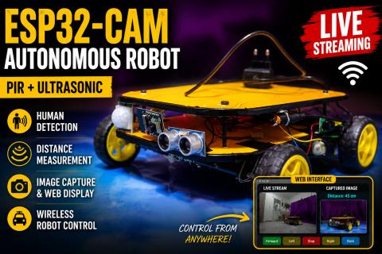
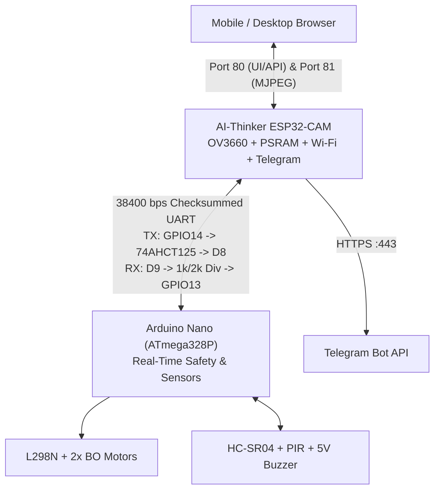

# ESP32-CAM Autonomous Surveillance Robot

> **Demo Video:** [Esp32 cam based obstacle detection and capturing robot](https://www.youtube.com/watch?v=9W-vfZcfwpw)

[](https://www.youtube.com/watch?v=9W-vfZcfwpw)

A modular, dual-controller (**AI-Thinker ESP32-CAM + Arduino Nano**) autonomous surveillance and obstacle-avoiding robot featuring live browser MJPEG streaming, wireless motor control, PIR motion-triggered image capture, ultrasonic distance measurement, emergency obstacle braking, buzzer alerts, and Telegram Bot API photo notifications.

> **Project Provenance Note:** The original prototype firmware and wiring documentation were lost. This repository is a clean-room engineering re-implementation built from the hardware inventory and reference image in [`source_material/PROJECT_BRIEF.md`](source_material/PROJECT_BRIEF.md) and [`docs/images/esp32-cam-robot-project.jpg`](docs/images/esp32-cam-robot-project.jpg). Option A wiring and hardware operation were confirmed bench-tested by the project owner on `2026-11-27`.

---

## Key Features

| Feature | Implementation | Status |
| :--- | :--- | :--- |
| Live camera streaming in browser | OV3660 JPEG MJPEG stream on HTTP port `81` (`/stream`) | **Verified (User Bench-Tested)** |
| Wireless forward/back/left/right/stop | Mobile-friendly web dashboard + REST `/api/move` + UART | **Verified (User Bench-Tested)** |
| PIR human motion detection | Arduino Nano `D12` input → `$TEL` → ESP32 rising-edge trigger | **Verified (User Bench-Tested)** |
| Ultrasonic distance measurement | HC-SR04 (`D10`/`D11`) with 25 ms echo timeout (`20–4000 mm`) | **Verified (User Bench-Tested)** |
| Obstacle emergency motor stop | Real-time Nano 2-sample hysteresis (`≤20 cm`) blocks `FORWARD` | **Verified (User Bench-Tested)** |
| Motion-triggered image capture | `CameraManager` acquires OV3660 frame on PIR rising edge | **Verified (User Bench-Tested)** |
| Web image display & gallery | 6-slot PSRAM ring buffer (`/api/photo?id=...`) | **Verified (User Bench-Tested)** |
| Distance associated with captures | Each captured photo stores & displays ultrasonic `distMm` | **Verified (User Bench-Tested)** |
| Buzzer alert functionality | Non-blocking active/passive 5V buzzer driver (`Nano A0`) | **Verified (User Bench-Tested)** |
| Telegram image notifications | Async Core-0 `WiFiClientSecure` `POST /sendPhoto` | **Verified (User Bench-Tested)** |
| Mobile-friendly web dashboard | Responsive zero-CDN HTML5/CSS3/JS served from `PROGMEM` | **Verified (User Bench-Tested)** |

*(Note: No AI object detection or face recognition is implemented; motion detection uses the hardware PIR sensor.)*

---

## Hardware Components

See [`hardware/BOM.md`](hardware/BOM.md) for the complete inventory separating **Already Owned** components from **Additional / To-Be-Verified** items (`74AHCT125`/`74HCT125` buffer, `1 kΩ`/`2 kΩ`/`10 kΩ` resistors, NPN transistor + `1N4148` diode, bulk/ceramic capacitors, and provisional `3.0 A` fast-blow fuse).

- **Primary Controller:** AI-Thinker ESP32-CAM + **OV3660** 3MP camera (24-pin FPC) + `ESP32-CAM-MB` programmer
- **Real-Time Co-Processor:** Arduino Nano (`ATmega328P`, `5V / 16 MHz`)
- **Sensors & Alerting:** PIR motion sensor, HC-SR04 ultrasonic sensor, small 5V buzzer
- **Actuation:** L298N dual H-bridge motor driver (`5V-EN` jumper **REMOVED**), 2× single-shaft BO motors (`6–12V`)
- **Power:** `12V, 3A` DC adapter, DC-DC Buck Converter (`≥ 2.0 A` continuous, tuned to `5.00V ± 0.10V`), capacitors, resistors, `3.0 A` fuse (**provisional**)

---

## System Architecture



For detailed firmware, communication sequence, and sensor flowcharts, see [`docs/ARCHITECTURE.md`](docs/ARCHITECTURE.md).

---

## Working Principle

1. **Arduino Nano** polls the HC-SR04 ultrasonic sensor every `60 ms` and reads the PIR sensor (`D12`). If two consecutive ultrasonic readings fall at or below `OBSTACLE_STOP_CM` (`20 cm`), the Nano immediately cuts forward motor drive, activates the pulsed buzzer alarm, and reports `obs=1` over UART.
2. **Motor Safety:** Motor direction changes enforce a `100 ms` coast dead-time before reversing polarity, ramp PWM smoothly (`ENA`/`ENB`), and automatically stop if the ESP32-CAM heartbeat times out (`1200 ms`).
3. **ESP32-CAM** streams live OV3660 MJPEG video on port `81`, serves the responsive dashboard and JSON API on port `80`, captures a JPEG frame paired with the latest ultrasonic distance on PIR rising-edge events (with `8000 ms` cooldown), and queues Telegram photo alerts asynchronously on Core 0.

---

## GPIO, Wiring & Power Documentation

- **GPIO Audit & Proposed Pin Tables:** [`docs/GPIO_FEASIBILITY.md`](docs/GPIO_FEASIBILITY.md) & [`hardware/GPIO_MAPPING.md`](hardware/GPIO_MAPPING.md)
- **Wiring & Level-Shifting Diagrams (`PROPOSED`):** [`hardware/wiring_diagram/WIRING_DIAGRAM.md`](hardware/wiring_diagram/WIRING_DIAGRAM.md)
- **Power Budget & Safety Checklist:** [`docs/POWER_DESIGN.md`](docs/POWER_DESIGN.md) & [`hardware/power_distribution/POWER_DISTRIBUTION.md`](hardware/power_distribution/POWER_DISTRIBUTION.md)
- **Known Hardware Unknowns:** [`docs/KNOWN_UNKNOWNS.md`](docs/KNOWN_UNKNOWNS.md)

> **CRITICAL SAFETY:** Never connect `12V` to any ESP32-CAM, Arduino Nano, `74AHCT125`, or `5V` sensor pin. Complete the pre-power-up checklist in [`docs/POWER_DESIGN.md`](docs/POWER_DESIGN.md) before energizing hardware.

---

## Installation, Compilation & Flashing

1. **Configure credentials (local only, never committed):**
   Copy [`config/config.example.h`](config/config.example.h) to `config/config.h` and fill in your 2.4 GHz Wi-Fi and Telegram details. See [`software/telegram/TELEGRAM_SETUP.md`](software/telegram/TELEGRAM_SETUP.md).
2. **Compile both targets with PlatformIO:**
   ```powershell
   $env:PLATFORMIO_CORE_DIR = "$PWD\.pio-core"
   .\.pio-venv\Scripts\pio.exe run
   ```
3. **Flash ESP32-CAM & Arduino Nano:**
   Follow [`docs/BUILD_GUIDE.md`](docs/BUILD_GUIDE.md) (always disconnect `12V` and external `5V` from the Nano before connecting USB).

---

## Testing Summary

See [`docs/TEST_REPORT.md`](docs/TEST_REPORT.md) and [`tests/test_plan.md`](tests/test_plan.md) for full test results distinguishing:
- Executed Python unit/integration & static security tests (`tests/unit/`, `tests/integration/`)
- PlatformIO firmware compilation (`esp32cam` & `nanoatmega328`)
- Physical hardware tests (marked **`NOT RUN`** until hardware is wired and reviewed)

---

## Known Limitations & Future Improvements

- **Known Limitations:**
  - MicroSD card slot is disabled because `GPIO 13` & `GPIO 14` are used for `Serial2`.
  - Dual-motor stall current, existing Buck Converter rating, and buzzer active/passive type are unverified on physical hardware ([`docs/KNOWN_UNKNOWNS.md`](docs/KNOWN_UNKNOWNS.md)).
  - Tethered `12V 3A` adapter limits physical travel range.
- **Future Improvements:**
  - 3S LiPo + BMS battery pack for untethered operation.
  - Web-configurable threshold & Wi-Fi captive portal (`Preferences` NVS storage).
  - MOSFET motor driver (`TB6612FNG`) to eliminate L298N BJT voltage drop.

---

## License

MIT License — see [`LICENSE`](LICENSE).
