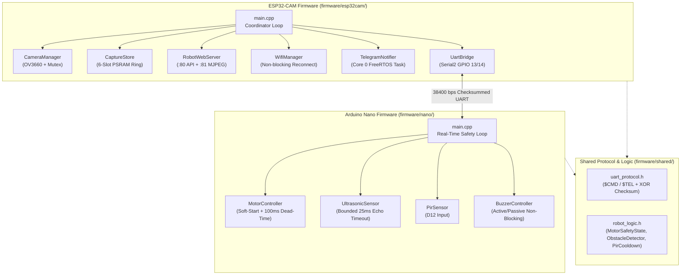
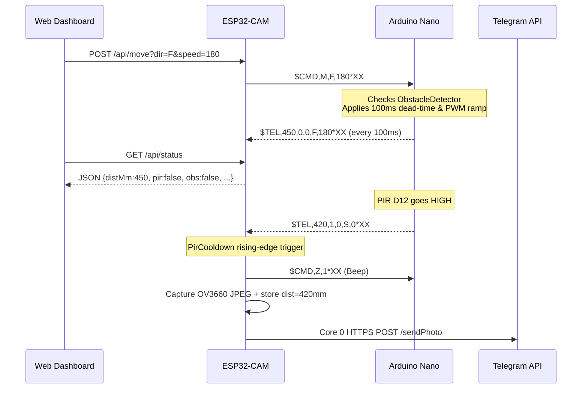
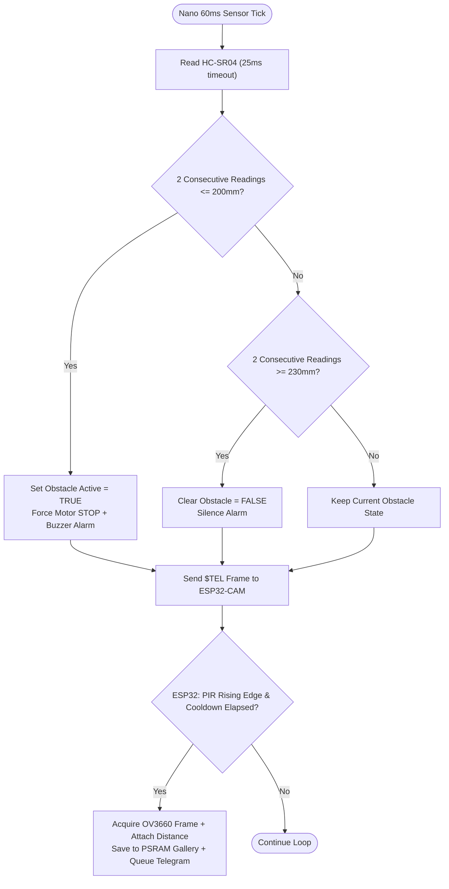

# System & Firmware Architecture — ESP32-CAM Autonomous Surveillance Robot

This document details the dual-controller **Option A** architecture (`AI-Thinker ESP32-CAM` + `Arduino Nano`).

---

## 1. Firmware Architecture Diagram

---

## 2. Communication Flow Diagram

---

## 3. Sensor Event & Safety Flowchart

