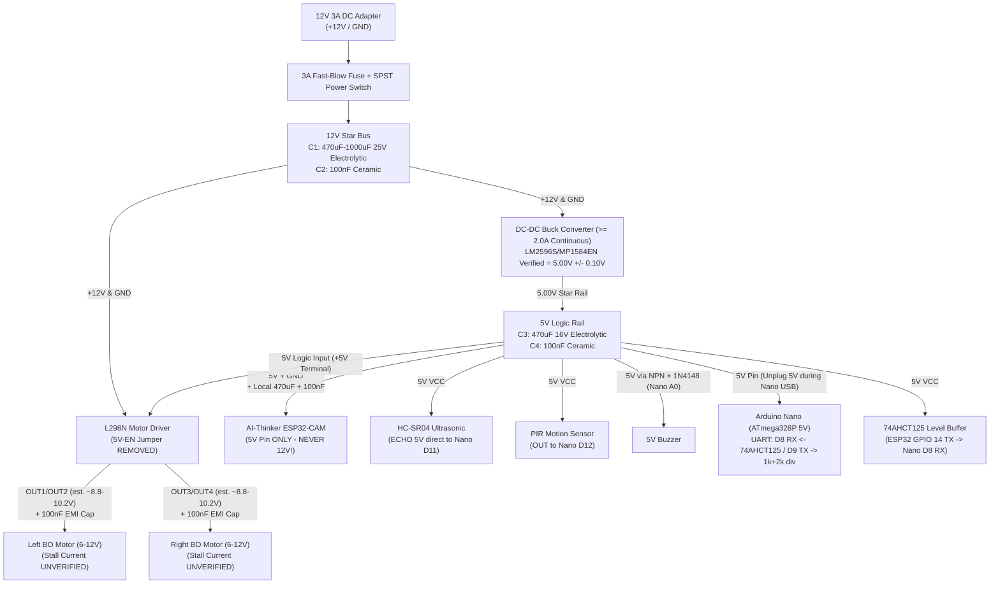

# Power & Electrical Safety Design — ESP32-CAM Autonomous Surveillance Robot

> **Status:** PHASE 1 REVISION (`PROPOSED` — **NOT YET APPROVED FOR HARDWARE POWER-UP**)  
> **CRITICAL SAFETY WARNING:**  
> 1. **NEVER connect the 12V adapter directly to any ESP32-CAM pin (`5V`, `3V3`, or GPIO).**  
> 2. **DO NOT power up the robot** until all wiring is verified, your Buck Converter model/rating is confirmed (**≥ 2.0 A continuous**), and its output is adjusted and measured with a multimeter to **5.00V ± 0.10V** unloaded.  
> 3. **Evidence Discipline:** This document separates **Datasheet / Nominal Specifications** from **Engineering Estimates** and **Unverified Physical Measurements**. Nothing here is a physical measurement of your specific hardware.

---

## 1. Supply, Motor Stall Uncertainty & 12V Adapter Feasibility

| Parameter | Datasheet / Nominal Spec | Estimated Range | Physical Status |
| :--- | :--- | :--- | :--- |
| **Main Adapter** | `12.0 V DC`, `3.0 A` max (`36.0 W`) | — | **UNVERIFIED** (measure polarity & unloaded `V`) |
| **2× BO Motors (6–12V)** | Rated `6–12 V` | Running: `150–350 mA` each; Stall: `0.8–2.5+ A` each | **STALL CURRENT UNKNOWN / UNVERIFIED** |
| **L298N H-Bridge Drop** | Datasheet $V_{CE(\text{sat})}$ sum: `~1.8 V` (typ @ 0.5A) to `3.2–4.9 V` (max @ 2A) | `~8.8–10.2 V` to motors at light/medium load | **ESTIMATED (NOT MEASURED)** |

### Can the `12V, 3A` Adapter Support Both Motors + Logic System?
- **Logic System Load on 12V Bus:** At `~720 mA` peak 5V load (`3.6 W`, Flash LED OFF) and conservative `80%` Buck Converter efficiency, the Buck draws `3.6 / (0.80 × 12) ≈ 0.38 A` from the 12V bus (or `~0.51 A` if Flash LED is pulsed).
- **Remaining 12V Budget for Both Motors:** `3.00 A − 0.38 A = 2.62 A` (`~2.49 A` with Flash LED).
- **Verdict:**
  - **Normal Rolling Operation:** **FEASIBLE** (estimated `0.3–0.7 A` combined motor draw leaves `>1.9 A` headroom).
  - **Stall / Abrupt Reversal Condition:** **UNVERIFIED / AT RISK.** Because actual motor stall current is **unknown**, simultaneous stall of both motors (if > `1.3 A` each) would exceed `3.0 A`, tripping the adapter's over-current protection and causing ESP32-CAM brownouts.
  - **Required Actions:** Measure each motor's winding resistance $R_w$ before full-load runs; firmware will enforce PWM soft-start ramping, `100 ms` stop dead-time before direction reversal, and ultrasonic emergency stop.

---

## 2. Buck Converter Identification & Recalculated 5.0V Power Budget

- **Existing Buck Converter Status:** Model, switching IC, and continuous current rating of your owned Buck Converter are **UNKNOWN / UNVERIFIED**.
- **Required Minimum Specification:** **Regulated `5.00 V` DC-DC Buck Converter rated ≥ `2.0 A` continuous (`3.0 A` peak)** — specifically an **`LM2596S` 3A module** (`4.5–40 V` in, `~150 kHz`, `≥ 2.0 A` continuous without extra heatsink) or **`MP1584EN` 3A module** (`4.5–28 V` in, `≥ 1.8–2.0 A` continuous).

### Complete Recalculated Power Budget (5.0V Rail + 12V Bus)

| Subsystem | Rail | Est. Typical | Est. Peak | Basis / Status |
| :--- | :---: | :---: | :---: | :--- |
| **AI-Thinker ESP32-CAM + OV3660** | `5.0V` | `180–260 mA` | `400–550 mA` | Datasheet/typical estimate (Wi-Fi TX + JPEG); +`150–300 mA` if Flash LED ON |
| **Arduino Nano (`ATmega328P`)** | `5.0V` | `25–50 mA` | `60 mA` | Datasheet typical @ 16 MHz / 5V |
| **L298N Logic (`+5V` / `VSS`)** | `5.0V` | `36 mA` | `50 mA` | L298N datasheet $I_{SS}$ (`5V-EN` jumper REMOVED) |
| **HC-SR04 Ultrasonic** | `5.0V` | `15 mA` | `20 mA` | Datasheet nominal |
| **PIR Motion Sensor** | `5.0V` | `<1 mA` | `3 mA` | Datasheet nominal |
| **5V Buzzer (via NPN Switch)** | `5.0V` | `15–30 mA` | `35 mA` | Estimated (type unknown) |
| **`74AHCT125` Level Buffer** | `5.0V` | `<1 mA` | `2 mA` | Datasheet quiescent + UART switching |
| **Total 5.0V Rail** | **`5.0V`** | **`272–393 mA` (`1.36–1.97 W`)** | **`570–720 mA` (`2.85–3.60 W`)** | **Up to `~1.0 A` (`5.0 W`) if Flash LED active; `2.0 A` Buck has `2.8×` margin** |
| **Buck Draw from 12V (@ 80% eff.)** | `12.0V` | `142–205 mA` | `297–375 mA` | `P_5V / (0.80 × 12V)` |
| **2× BO Motors (via L298N)** | `12.0V` | `300–700 mA` | `UNVERIFIED` (up to `2.62 A` max remaining) | **Stall current unmeasured** |
| **Total 12V Adapter Bus** | **`12.0V`** | **`~0.44–0.91 A`** | **`≤ 3.00 A` adapter limit** | **Protected by `3.0 A` main fuse** |

---

## 3. L298N Module Configuration & Thermal Limits

1. **`5V-EN` Jumper Configuration:** **REMOVE the `5V-EN` jumper.**
   - *Installed:* Connects onboard `78M05` linear regulator (`12V → 5V`) to L298N logic and outputs 5V on the `+5V` terminal.
   - *Removed (PROPOSED):* Disables the `78M05` completely and configures the L298N `+5V` screw terminal as an **external `5.0V` logic input (`VSS`)** powered by the Buck Converter. This eliminates `78M05` heat dissipation and prevents parallel-regulator conflict.
2. **L298N Datasheet & Thermal Limits:**
   - Logic supply $V_{SS}$: `4.5–7.0 V`; Motor supply $V_S$: up to `46 V`.
   - Output current: **`2.0 A` DC continuous per channel** (`2.5 A` repetitive, `3.0 A` non-repetitive peak); max total package dissipation $P_D = 25\text{ W}$ at $T_{\text{case}} = 75^\circ\text{C}$.
   - **Thermal Reality on Standard Module Heatsink:** With its small aluminum heatsink, continuous dissipation above ~`4–5 W` makes the heatsink hot (`>70°C`). At an estimated `0.5 A`/ch (`~2.0 V` drop × 2 = `~2.0 W`), it runs cool-warm. A sustained stall at `2.0 A`/ch (`~3.2 V` drop × 2 = `~12.8 W`) will trigger L298N thermal shutdown.

---

## 4. Fuse Selection Justification (`PROVISIONAL`)

- **Selected Fuse:** **`3.0 A` Fast-Blow Fuse** (`5×20 mm` glass or automotive blade) in series with the `12V` adapter `+` wire before the star bus — **Status: PROVISIONAL**.
- **Justification & Verification Pending:** Matches the `3.0 A` continuous rating of the `12V 3A` adapter and sits below `20–22 AWG` chassis wiring ampacity. However, this selection remains **provisional** until the specific fuse's time-current (`I²t`) curve is checked against motor startup inrush and actual wire gauge protection limits.

---

## 5. Power Distribution Diagram (Option A — `PROPOSED`)

---

## 6. Pre-Power-Up Safety Checklist (Mandatory Before Energizing)

1. [ ] Verify **12V adapter polarity** and unloaded voltage (`~12.0V`) with a multimeter.
2. [ ] Confirm Buck Converter IC/model is rated **≥ 2.0 A continuous**.
3. [ ] Power **ONLY** the Buck Converter from 12V and tune output to **`5.00V ± 0.10V`** unloaded. Power off.
4. [ ] Confirm **L298N `5V-EN` jumper is REMOVED** and L298N `+5V` terminal connects to the `5.0V` Buck rail.
5. [ ] Verify **zero short circuit** between `12V`, `5V`, `3.3V`, and `GND`, and **zero 12V connection** to ESP32-CAM, Nano, `74AHCT125`, or sensors.
6. [ ] Measure BO motor winding resistance $R_w$ to estimate stall current; keep wheels elevated during initial motor tests.
7. [ ] Never plug Nano USB while external `5.0V` Buck rail is connected to Nano `5V`.
